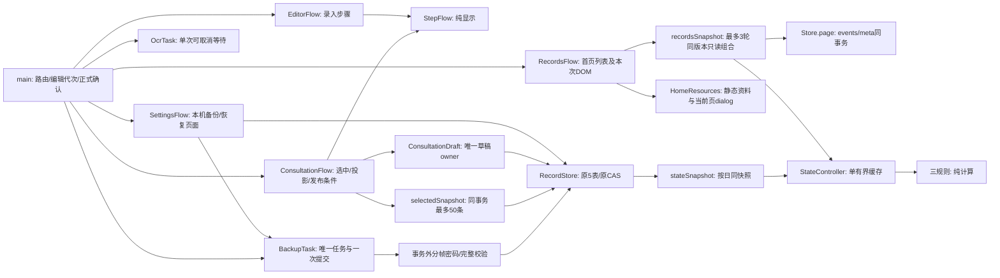

# 当前H5模块与资源地图

准确版本及运行证据以STATUS.json、ACCEPTANCE.json为准。本图为R19当前结构，保留R16已通过的草稿/异步边界；旧图原字节保留于Git基线14d604cb26227d1562e2f520f7fe9b7daf20db00。唯一根003-PTDS-FLASH-H5，不加载主PTDS、旧根或隔离状态。

## 写入、锁与结果所有权

没有应用级全局互斥锁。ActionCoordinator只串行当前UI写动作，至多保留一个可替换导航，不队列或重发写入；已发布导航不继续持有操作权。IndexedDB仅在原正式事务中串行相关表，网络、密码、图片哈希均事务外。OCR费用锁只保护一次本地预算预留，供应商网络在锁外；运行进程的费用账本锁身份不变。

| 资源/接口 | 读写及一致性边界 | 唯一owner与释放/失效 |
|---|---|---|
| stage/confirm/save | Service校验摘要与本人动作；Store正式原子提交 | main+Coordinator；编辑作废确认，不重放权限/换请求ID |
| Store.open/close | 当前generation/opening才可接连接或升级；过期upgrade abort | Store；close失效等待者/关连接与频道；已开始事务正常结算 |
| Store事务/通知 | complete决定原提交结果，通知是独立派生观察 | 每个Store自己的listener快照/频道；同步和异步观察异常只计饱和数字 |
| 录入步骤 | 无I/O/锁/存储，只操作hidden/aria-current | 当前EditorFlow/StepFlow |
| OCR | 每次显式上传至多一次请求；路由/来源/取消后结果失效 | OcrTask一个AbortController；main编辑或导航立即取消，迟到hash不得发布 |
| selectedSnapshot | events/meta同一只读事务、≤50主键，无原图Blob | ConsultationFlow捕获页面/选中代次及草稿identity/version，conflict禁止发布 |
| 问诊草稿保存 | meta原CAS、context清空屏障，complete后才成功 | ConsultationDraft一个pending值/活动Promise/500ms timer；失败清timer，冲突优先于旧成功/失败 |
| 草稿load/reload | 一次显式context初始化后只读快照；通知代次校验，至多3次只读重取 | 同一个ConsultationDraft；草稿/reset/临床通知使旧读失效，成功前不替换本页文字，dispose终止发布 |
| 问诊投影显示 | 只在当前owner/版本未变且无冲突时替换；错误和放弃都有可见终态 | 当前Flow；旧mount不操作新页面，无后台生成/网络 |
| stateSnapshot | 同事务events/meta；原date索引按日读；最多原2万条 | Store读事务；计算在事务外，StateController一个缓存，revision/代次复核 |
| backupSnapshot | 正式记录/回执/相关原件/settings的同事务快照 | Store原表；输出不含未完成录入/问诊草稿 |
| encode/decode | 原格式3、256KiB密码帧；legacy1/2保持兼容 | 单任务临时数组；原始片≤128/1MiB组装Blob，finally释放；完整输出仍随总量占空间 |
| BackupReader | inspect独占≤1MiB密文窗口；跨窗/UTF8保真 | close不可逆；迟到读回不回填，finally释放窗口 |
| inspect/restore | 密码/摘要/关系在事务外；预览非写许可，提交事务再查冲突/容量/时区 | BackupTask唯一owner；commit至多一次，已开始原子提交不可取消 |
| 静态壳 | SW只缓存同版静态资源，无API缓存/skipWaiting/强制刷新 | 构建产生版本，关旧页后激活 |

## 规模与工程限制

原容量不变：2万正式记录、100未完成录入、每条100观测、8MiB/2400万像素单图、在线2MiB、备份原图64MiB/明文128MiB、选中≤50、问诊文本≤1000000 UTF-16单元。1MiB读窗不等于浏览器总内存恒定；Blob/元数据和最终事务仍随总量增长。

完整规模窗口必须使用原stage→confirm→save生成的1千→3千→6千→1万虚构记录。状态冷p95≤1000ms/暖≤250ms，问诊分页/50条投影p95≤250ms，备份心跳p95≤250ms；64MiB原图和最大暂停另列。旧首次卡顿不因新窗口通过就被撤销或唯一归因。实机物理内存/真实低空间需真实设备证据。

## 防止新增技术债

- 新功能先冻结模块/数据流/写集，说明是否持锁和10倍影响。main只接线，不堆展示、规则或存储实现；约1500～2000行文件不再增长。
- timer、AbortController、缓存与队列各有单一owner、容量/期限和释放路径；旧异步结果必须核查owner/代次。读不得静默写或启动后台任务。
- 新用例同包进入tools/test_plan.json及实际完整入口，只有白名单而未执行仍是缺口。原版反例、修复对照、有效退化及工具失败均保留。
- tools.verify_debt绑定源码/测试/工具/计划的逐文件Hash；build必须显式本版成功凭证，漏文件、增文件或改一字节均失效。
- 复用原Store、WebCrypto和标准浏览器能力；无新增依赖。真实数据、费用、医学算法/阈值不作为普通工程修复顺带改。

## 首页双入口：R17批准合入

用户批准原效果图，并明确二维码点击必须放大。features/home_resources.js只输出两个独立静态入口和原图dialog；app/home_resources.js只绑定本页两个监听，卸载移除监听并关闭原生dialog。main仅import、一个唯一卸载handle和三个离页接点，净增4行（159→163）。无全局document监听、timer、锁、DB或业务请求；手册为标准新标签a链接，不附病程数据，不预取外站。二维码是同源151945字节原JPEG，只增加恒定静态加载/离线缓存；数据10倍不增加工作。

样式独立且全作用域化，用既有字号变量；原style.css/typography.css/records模板字节保持。旧style golden只排除用户批准新增的.home-resources子树，原首页所有旧节点仍逐项比较；新增子树独立进行五宽度/160%字号、实际图片点击放大/关闭回焦/离页释放/重新进入/原图SHA验证。老浏览器没有showModal时仍有标准本地原图链接，closed dialog显式隐藏。gateway只加入.jpg静态扩展名，原路径保护和API/预算保持。

实装结果及技术债扫描见HOME_RESOURCES_R17.md与evidence/r17-debt-scan.json，准确整版通过从STATUS/ACCEPTANCE进入，不使用R16或静态图替代新版本验收。

## R18职责拆解与锁边界实测

main仍唯一拥有路由、filter/cursor、编辑确认和页面generation；RecordsFlow只接收当前Store/StateController和导航接点，本次page快照在页面闭包，卸载handle交还main。SettingsFlow只接收原Store/BackupTask及原on动作入口，本次inspection在页面闭包；返回过期时必须让navigate也早返回，防止旧分支发布新动作。没有第二存储、全局状态修改入口、锁或后台任务。

main从18121字节/163行减至15072字节/132行；不以少行数掩盖密集代码，原录入与确认职责仍在main。本机、首页列表已分离，不继续为追求文件数拆细。公共style从808行拆为293/166/83/94/66/106六份，连接后逐字节等于原13021字节、原SHA；HTML同级link顺序完全保持，之后仍原字体/资料模块。五尺寸拆前/拆后所有页面计算样式逐项相等。最大前端文本293行；生成rules/definitions.js的数据常量不是待手工拆的业务代码。

慢虚构provider测试实际等待期间，Budget.lock可立即取得；静态GET、OCR配置GET、重复请求409和并发429均能返回，网络不在预算锁内。4并发、16唯一预留尝试准确10次成功/6次预算拒绝，重建Budget读回同账本后仍拒绝超额；必要持久预留锁/进程owner锁不拆，未声称提速。源/测试/工具准确当前凭证从STATUS/ACCEPTANCE进入，R17本人声明不搬作R18本人/独立/临床签收。

## R19主页列表与三卡的同版本发布

R18用户已声明“实机验证通过”，本人声明单独记ACCEPTANCE，不升级成物理内存/真实低空间逐项量测。复扫实际复现：page取得旧快照后另一连接正式保存，原主页在导航忙碌期间只失效缓存、未排刷新，可能显示旧病程；不涉及丢库。

Store.page仍原日期索引与≤50条限制，读事务由events扩为events/meta，新增内部返回revision；不升级IDB、无写入，也不影响正式wire/备份格式。独立recordsSnapshot同时取原page/StateController，要求page、三卡、发布前当前revision一致，最多3轮只读；StateController原内部3次上限保留。页面已过期返回null；持续变化报可见RECORDS_CHANGED_TRY_AGAIN，由用户显式再进“状态”，不加后台轮询，不将读失败改成写重试。记录分页与卡片覆盖日期可以不同，版本必须相同。

main、所有CSS、写入协调、正式保存/确认、备份核心、OCR/预算及规则原字节。71项保护运行文件逐字节不变，新辅助模块15行；Store除page方法外逐字节相等，ui只加一条错误映射。无新锁、timer、队列、缓存、存储。正常增加同源JS模块固定请求及一条小meta只读，十倍规模继续跑完整原门槛；未测前不说提速。详情及当前证据见DEBT_AUDIT_R19。
