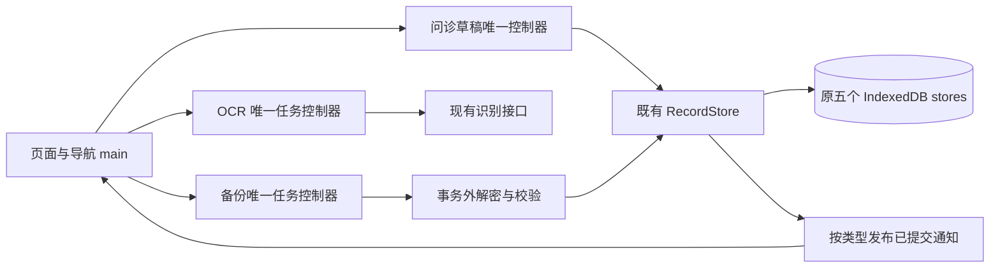

# H5 技术债修复审批方案 R05 / R01

状态：待用户批准；仅完成只读核查及新建本方案。2026-11-07。

## 决策内容

推荐 A：在新 R05 副本，串行完成四批根因修复和防复发检查。范围较完整，备份手机内存必须实机验收后才能结项。

B：仅完成第一批问诊草稿防丢与对应检查。改动小、先解决文字丢失，识别等待、备份和样式债保留，后续另定。

批准 A 或 B 同时表示：指定本会话 Codex 为对应新副本唯一 Writer；允许所选批次内的开发、虚构数据自测、修复及打包，不必逐步再次索批。仍不自动发布公网。此方案本身不构成批准。

**关键取舍：**问诊草稿只在本浏览器自动保存，不成为正式病程，也不进入现有病程备份；页面说明草稿需另行复制或下载。病程更新后保留手动文字并标明资料已变，不把旧卡当成当前结果。不能承诺任何错误永不发生；可承诺把已知复现路径变为必跑行为检查，未通过不得形成可采用交付。

## 核查基线与证据边界

- 当前根 `/Users/osszhaoke/Downloads/PTDS-H5-sjia-mas-r04`，HEAD `a59244b8e467db67b90d51526dda70c18f4e292f`，核查时工作区干净。319 个跟踪文件实际字节 Hash 已固定于 `baseline-binding.json`。
- 当前 `STATUS.json`、`docs/DEBT_RESCAN.md`：本范围未确认 P0/P1，3 项 P2、1 项 P3。这是作者定点复扫，不是全工程、安全或临床审计。
- 代码核查：`consultation_flow.js` 的 `hideOutput()` 清空临时文本；`main.js` 的 OCR 经全局活动操作槽；`store.js` 的 meta 写入触发通用通知；备份仍持有输出 Blob 与元数据，缺少全过程取消。具体见下表。
- R04 作者自动化通过仅为历史基线；独立 Tester、本人、真机、临床和公网未验收。OCR 当前关闭，没有本轮真实慢请求证据。R03 万条恢复约44秒不能冒充 R04/R05 实测。
- 主 PTDS `.ai-context` 当前是早期 C0，未将其过时状态当作 H5 事实。本轮未读取真实浏览器、数据库、凭据或完整聊天；无服务启停。
- 汇报规范准确快照已读，Hash 见绑定文件；原权威路径不可访问，不声称已读更新版。AIh 未计量，不推算剩余额度。

| 编号 | 根因 / 用户影响 | 本批处理目标 |
|---|---|---|
| D13 / P2 | 问诊补充只在 DOM；切页、重生成、资料更新可清掉文字 | 独立草稿权威、保存状态、冲突保护与安全替换 |
| D12 / P2 | 可取消网络任务占用正式操作协调槽 | 独立任务所有者，退出后迟到结果不落页面或病程 |
| D05 / P2 | 备份任务缺进度/取消边界；仍有大对象，手机峰值未知 | 安全取消、减少重复持有、同环境测量及真机门槛 |
| D10 / P3 | 无入口历史选择器、紧凑模板增加维护成本 | 精确清理无用样式；业务与层叠结果保持 |

## 模块、数据流与锁地图

| 资源/接口（拟定名） | 读写及持有范围 | 一致性与取消 |
|---|---|---|
| `selectedSnapshot` | events/meta 同一只读事务，最多50条，无网络 | 内容与临床 revision 同一快照 |
| `readConsultationDraft` | meta 只读；不暗中初始化或改库 | 同时返回草稿 revision 与 context |
| `initializeDraftContext` / `writeConsultationDraft` | 显式 meta 短写事务；初始化/比较后写 | context + revision 的 CAS，冲突不静默重写 |
| 临床保存/删除/恢复 | 沿用原原子写事务；无网络/哈希/计时等待 | 完成后才发布 clinical 通知，确认权威不变 |
| 清空本机资料 | 原五表同一事务，另建立新草稿 context | 已排队旧草稿写入因 context 失配失败，跨页签同样有效 |
| OCR | 任务控制器持一个 AbortController，无 DB 锁 | 任务、路由、来源三重代次；无自动重试 |
| 备份任务 | 一次一个；密码、解密、哈希均在事务外 | 提交前可取消；最终原子提交期间禁取消 |

不新增全局锁、第二数据库或正式存储引擎；DB 仍 version2、原五表。草稿字段带独立 schema，不改临床 wire、规则或事件。未识别的旧版广播按临床可能变化保守失效，防止同 origin 旧页签通知被忽略。

规模涨10倍：病程分页仍每页50条，选中上限50；草稿最多一份，维持现有文本上限1,000,000个 UTF-16 单元，不按病程数量增加。备份仍受原容量限制，须实测处理时间和内存，不宣称恒定总内存。

## 第一批：问诊文字防丢（最小可独立验收任务）

1. 新草稿控制器唯一拥有当前文字、选中ID、生成来源指纹、revision、保存状态。提示词始终由当前文字派生，不再成为另一份可失步权威。
2. 在既有 meta 保存一份当前草稿；无历史堆积、无自动过期、无自动上传。工程建议：输入停止500ms后写入，导航主动 flush；同时最多一个写入和一个可替换的最新待写值。该时间为本次审批的工程默认，不是医疗或业务阈值。
3. 事务完成后才显示“已保存到本机”。写失败/空间不足保留屏幕文字，显示未保存，提供重试、复制、下载。导航须完成保存或让用户明确选择离开；待保存时刷新/关闭使用浏览器允许的提醒。
4. 刷新及真正退出浏览器进程后恢复已提交草稿。突然强杀只能保证恢复最后一次已提交内容，不能保证尚未提交的最后输入；不夸大浏览器持久性。
5. 修改选择或临床资料后保留编辑文字，标明来源已变。重新生成需明确确认替换；取消则保留。删除来源后不崩溃、不悄悄混入新病程；旧内容可复制/下载，不能无提示当成最新问诊卡。
6. 草稿保存发布 draft 通知，不改 clinical revision、不触发自身失效循环。另一页签已写新版本时 CAS 拒绝覆盖，保留本页文字并提供下载或载入新版本；不无限缓存冲突副本。
7. 清空、恢复和上下文切换前暂停草稿写入并处理未保存内容。清空使用新 context 阻断旧页签迟到写入；恢复成功后临床 revision 变更使草稿标旧；失败或取消不谎称恢复完成。读接口不初始化 context。

验收：切四个页面再返回、刷新、不同PID同测试库重开、重新勾选/分页/清选、重生成取消与确认、病程变更/删除、多页签竞争、延迟与乱序通知、清空+待写竞争、配额失败逐例通过。最后一次显示已保存的文字逐字一致，正式病程/确认状态未被草稿写入改变，自动网络请求0。保存失败不得显示成功或清空输入。

## 第二批：识别等待与保存解耦

独立 OCR 控制器拥有单个任务，脱离正式保存槽。导航先执行离开保护；用户同意离开后中止客户端等待并立即路由。每个异步边界前后核对任务ID、路由代次及源身份，含识别返回后的源哈希步骤。旧响应不能覆盖新图片或页面，不能产生正式保存。

取消只表示停止本机等待，不承诺撤销服务商已处理的请求或费用。保留一次请求、原请求身份和原费用保护，无自动重发、新ID补发或收费实测。

验收：本地可控慢响应、永不返回、取消、退出再入、切图片、迟到成功/失败及异常均覆盖；明确同意离开后100ms内发起 abort 与导航（不包含目标页读取耗时）。正式写入继续只接受一次，不排队重放；全部使用模拟服务，实际付费调用0。

## 第三批：备份进度、安全取消和内存证据

阶段为读取/解密→校验→预览→最终原子提交。前三阶段可取消，取消后不产生临床写入、释放任务引用；最终提交开始前再检查取消令牌并互斥切换状态，开始后按钮禁用且显示正在保存。提交保持全有或全无，事务内不 await；冲突/配额失败回滚。取消不能伪装成成功。

保留格式1/2/3读兼容、格式3写入、既有鉴别/密码派生/容量及原件上限，不自研新密码算法。减少解码记录中间集合的重复持有；预览冲突只读取所需身份字段，替代读取全部现存内容。源哈希单张最多8MiB缓冲、256KiB帧、输出 Blob 和元数据仍明确计量，不承诺浏览器总内存恒定。进度只报已完成工作，最终提交前不显示100%成功。

先在同环境测原版，再改代码并测新版；原始失败/中断窗口保留，不拼接样本。用虚构1千→1万条和合法64MiB原件边界，记录总耗时、阶段耗时、取消延迟、活动帧及元数据计数和字节；不混测不同环境。目标：可取消阶段500ms内响应取消并不再继续下一处理单元（WebCrypto已发起调用不可抢占，待其返回核查令牌且不得提交）；UI处理阶段心跳间隔p95≤250ms。最终单次IDB提交单独计时，不用前述心跳目标掩盖它。

验收包括密码错、鉴别失败、截断、乱序、尾随字节、旧格式、跨时区/重复冲突、取消与提交竞态、配额回滚。iOS Safari与Android Chrome需使用虚构资料跑真实备份/恢复、核对记录及原件字节，并记录机型、系统、版本、容量和可获得的资源测量；只用Mac模拟不能把真机内存债结项。真机结果缺失就保持 D05 部分完成。若合法容量仍崩溃，集中提出降容量或新的流式方案，不暗降64MiB限制、不引入另一存储引擎。

## 第四批：仅清理历史样式

基于真实填充页面的模板、动态类和CSS使用关系核查选择器；不能用 `.card` 字符串命中 `.state-card` 就判定有用或无用。先存计算样式与截图，再删除确定无入口的精确选择器；有疑问保留并说明。模板拆分仅做行为零变化整理，语义改动另提交。

独立提交纯样式清理；对比320/390/430/620宽及320宽160%字号，覆盖三卡/详情/日历、录入各步骤、问诊选中/生成/冲突、本机/备份各状态。保持正文及辅助字底线、日历日期≥20px、触区≥44px；无横向溢出，计算样式差异逐项解释，不能搬用R03旧截图。

## 防复发机制与通过门槛

- 每个已知根因配行为回归并在同批登记 `tools/test_plan.json`。恢复旧缺陷的隔离变异必须被行为断言杀死，附未变异对照；准备失败不算抓住缺陷。
- 单一本地入口 `python3 -B -m tools.verify_debt --output <新目录>` 执行显式白名单。覆盖当前全部Node基线、相关Python基线、所选批次浏览器/变异/规模/重开检查，不使用通配discover。修复现有 `npm test` 漏跑协调器/问诊测试的问题，使其跑齐显式Node白名单。
- 打包检查器绑定当前产品、测试、计划和工具Hash；缺少本版成功证据或证据已过期则非0退出，不允许把旧PASS用于新包。修改一字节使凭证失效、漏文件和错误Hash均有反例。此为仓库本地入口保护，不冒充全平台不可绕过的权限控制。
- 资源所有者/取消路径、队列上限、通知类型、事务内禁长I/O、同快照内容与版本、旧响应拒绝、写请求不重发均进架构登记与评审清单；用相应行为测试约束，文本检索仅为辅助。
- 万条规模目标继续为状态冷p95≤1000ms/暖≤250ms、问诊分页和50条生成p95≤250ms。测量串行，同环境基线后才能声称提速。新草稿写入不随临床记录数增加，不读取全库或Blob。
- 每批开始固定输入组合，结束保留失败、修复、对照及字节清单；普通工具失败在已批范围内自主修复，不放松有效断言。每批单独提交；前三批后第四批纯整理，不混入新业务。
- 作者自测、产品接入、真机、独立Tester、本人和临床分别登记。没有相应结果不得写全部通过；不自动唤醒其他会话。

## 审批后独占写集上限

新根仅为 `/Users/osszhaoke/Downloads/PTDS-H5-sjia-mas-r05`。若已存在则停止占用检查，使用新编号并公开路径，不覆盖。复制时排除 runtime、旧浏览器profile、凭据及缓存；旧证据只作历史，不带作新PASS。先在新根 `DECISIONS.md` 登记所选范围、用户批准及唯一 Writer，再实施。

| 批次 | 可改已有文件（新根相对路径） | 可新增模块/测试 |
|---|---|---|
| 一 | `web/app/{main,consultation_flow,ui}.js`；`web/features/{consultation,consultation_page,settings}.js`；`web/storage/store.js` | `web/app/consultation_draft.js`、`web/storage/consultation_draft.js`；`tests/{consultation_draft.test.mjs,browser.consult-draft.js,browser.consult-draft-persist.js}` |
| 二 | `web/app/{main,action_coordinator,editor_flow,ui}.js`；`web/features/editor.js`；`tests/{coordinator.test.mjs,browser.ocr.js,browser.experience.js}` | `web/app/ocr_task.js`；`tests/{ocr_task.test.mjs,browser.ocr-navigation.js}` |
| 三 | `web/storage/{store,backup,backup_stream}.js`；`web/app/{main,ui}.js`；`web/features/settings.js`；`tests/browser.backup-stream.js` | `web/app/backup_task.js`；`web/storage/backup_task.js`；`tests/{backup_task.test.mjs,browser.backup-task.js,browser.backup-scale.js}` |
| 四 | `web/{style,typography}.css`；`tests/{browser.css.js,browser.mobile.js}` | 不新增业务模块 |
| 所选批次共用 | `web/{index.html,sw.js}`仅版本/资源接线；`gateway/server.py`仅版本；`tools/{test_plan.json,run_browser.py,build.py,test_offline.py,test_upgrade.py}`；`package.json`；现有`tests/{browser.workflow.js,browser.compat.js,test_workflow_mutation_runner.py,test_deploy.py}`仅相关回归 | `tools/verify_debt.py`；`tests/test_debt_mutation_runner.py`；`tests/test_debt_build_gate.py` |

新根文档/交付允许：`DECISIONS.md`追加，`README.md`、`STATUS.json`、`ACCEPTANCE.json`、`docs/{ARCHITECTURE,DEBT_RESCAN,DELIVERY,PHONE_ACCEPTANCE}.md`；新建`docs/DEBT_R05.md`、`evidence/r05-*`证据目录；由现有构建产生并逐文件验证的源清单、静态清单、SW资源表及新R05部署ZIP，不改部署平台配置和额度。新模块只在上表内；需要扩大写集时先集中报差量。所有文件保持小职责，大文件只减不增。

旧根R04及以前、主PTDS、锁定规则核/JSON、临床wire与DB版本、OCR服务商/区域/预算/策略、历史包全部只读；无新增依赖、公共契约、真实数据读写、真实收费调用、DNS/云购买或公网发布。CASS继续暂缓，复用既有Store/任务/密码组件；未做外部开源检索，不声称查无方案。

## 预览、回退与停止点

本轮仅交方案，不启停服务。审批后先用自有新验证端口和全新虚构profile；最终若所选自动化检查通过，允许仅将本会话18791预览切换到R05，先核验实际PID/命令/cwd与R04停止记录，不符则保持服务不动并报告。保留原启动字节，正式预览只重启一次；不迁移、不读取当前使用者浏览器内容。

产品基线保持原库版本、旧临床/备份兼容。R05失败可恢复R04源码与原启动入口，但R04不显示新增草稿；这是已知降级，回退不会承诺帮用户保留尚未下载的问诊编辑。不得清库或拿真实备份做回退实验。

验收最小单位：先交第一批，以新建虚构草稿的“生成→补充→已保存→离开返回→刷新→新PID重开→逐字读回”及冲突/清空/空间不足反例独立验收。A批准后可继续其余已批批次；真机缺失只阻止对应结项，不把其他源码成果撤销。最终由用户验收；独立Tester与临床缺口保持，不自动上线。

本次方案停止条件：文档可审阅、基线未变、正文格式通过机械检查后等待用户批准。所选范围外的新业务/架构、安全或预算问题只停受影响片，集中报选项。AIh仍未计量，不虚构余额或完成日期。
