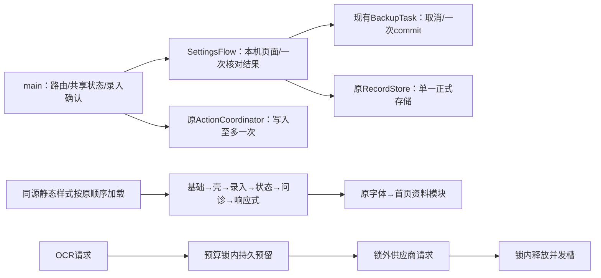

# R18｜全局锁核查与前端职责拆解

用户已声明R17本人验收通过，并批准推进结构治理。仅当前独立H5根，产品服务保持暂停；不是主PTDS计算锁工作。真实资料/密钥/隔离本地状态均不读取。独立、临床、实机物理指标继续分层。

## 先锁住行为的地图

锁地图：ActionCoordinator是一个活动UI动作与一个可替换导航；不重试写入。IDB事务只保护正式相关表，密码/网络在事务外。Budget实例锁保护检查+fsync预留+并发计数；供应商请求不在锁内。gateway进程文件锁防止同一本地账本双进程花费，HTTP semaphore最多16请求；它们不是跨功能计算全局锁。以上均保留，用实际慢provider并发断言验证。

拆解前main=18121字节/163行，style=13021字节/808行，不能以行数少忽略密集代码职责。首先移出本机备份/恢复/清除页面，原Store/任务/动作入口由main注入；本机预览对象由该次页面唯一持有。main保留路由、编辑、确认与共同代次。公共样式按R17原连续片段拆6份，原选择器、属性、顺序与媒体作用域逐字节不变；同级link避免@import瀑布，不改字体或UI文字。

10倍记录不增加新模块队列/DOM数量；没有新锁、timer、缓存、存储。新CSS文件是固定静态请求开销，不宣称请求为0。重用既有标准模块和浏览器能力，无新增依赖。既有56项及新结构/慢provider边界测试必须在当前binding全部通过；最终证据、差量和扫描在本报告收口，不借R17验收代签R18。

本轮不为消除锁而移除必要原子性，不改医学、容量、费用或默认业务规则；不宣称未测提速。

## 实施结果与可追溯范围

纯搬移提交：1abd406（完整Hash见后续回执），未混入身份/版本接线修改。main由18121字节/163行减至15072字节/132行；RecordsFlow15行、SettingsFlow36行，精确行数以扫描为准。原输入、确认、保存、草稿、备份密码格式和医学值不变。

公共样式准确分段293/166/83/94/66/106行，总808行、13021字节、SHA e3d109c888d85e3ba642c21ef1dae4243e2dfe15dae85fd609e85bb344cf9d77，与R17原字节相等；没有删除重复声明或重排媒体规则。5组尺寸的所有页面计算样式逐项相等，基线与拆后分别在evidence/r18-baseline01和r18-move-layout01。新增Node用例从HTML实际link顺序重建CSS检查，既有视觉/字号/触控门槛保持。新增锁用例进入实际Python完整入口，非只登记白名单。

64项保护运行文件逐字节相同；Budget、ActionCoordinator、Store、医学规则、OCR预算/费用、备份核心均原字节。运行4处身份接线仅r17→r18。没有新增全局锁/存储引擎/timer/队列/缓存；固定同源资源请求增加5份CSS和2份JS，记录十倍不增加它们的数量。

两项新增锁测试在原产品通过；首轮并发夹具用了16线程，超出原4并发门槛，导致正确OCR_BUSY而未达假设的10成功。evidence/r18-baseline01/locks.log保留原失败；改4线程、16唯一尝试后仍严格断言10成功/6预算拒绝并通过。不是放宽产品限制、自动重试或修复原本正确的锁。

最终准确完整凭证从STATUS/ACCEPTANCE进入；本轮本人/独立/临床未代签。R17本人“人类验收通过”已独立登记；手机物理总内存/真实低空间仍缺实机量测，旧首次卡顿历史原因仍未唯一归因。服务保持暂停，无真实收费调用，不触碰隔离状态。最终ZIP与同版绑定回执见evidence/r18-package-final.json。

## 最终准确完整窗口

R18完整56项全部PASS，68 Node/48 Python，evidence/r18-verification01/result.json；binding aad1f38d30f75ceea54390625fab7407f11a002934a3f3e31231c52f60114048。原56项一项未减，新结构/锁用例进入其实际Node/Python必需入口。临时虚构实例经过stage→本人确认测试动作→正式保存，不直接插库或读取真实状态。

同一完整窗口：万条状态冷/暖p95=318/0ms（0为计时分辨率结果，非零成本）；问诊分页/50条投影p95=10/4ms；万条备份核对7268ms、心跳p95/max=17/234ms；64MiB原图通过，最大密码缓冲262145字节、心跳p95=19ms。没有跨环境提速倍数或手机总内存推断。当前本地已登记可复现代码待修项0；原实机物理量测及历史归因缺口保留。
