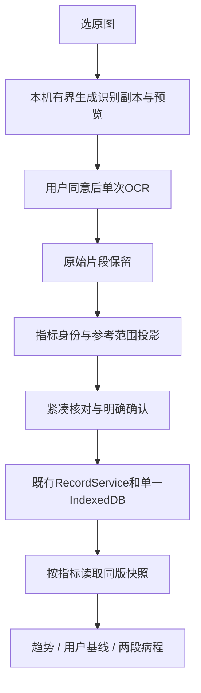

# 试用反馈分析与方案建议 R31

本轮已读《试用者问题.docx》的6条反馈和4张截图，并定向核对当前R30源码；只写分析材料，不改产品、不操作公网、不新增OCR调用。**“允许暂时隐藏问诊”为用户已批准的产品决定；趋势、基线、病程比较及新的核对交互仍是建议。问诊目前尚未从线上隐藏。**

主要判断：这批反馈说明录入后的核心价值还没闭环。当前能保存整表、展示三套参考规则及部分上次/本次变化；还不能让家属方便地查看任意常见指标趋势、选择稳定期基线、比较两段疾病活动过程。之前工程定向附条件通过不代表这些能力已交付。

## 六项反馈逐项分析

| 反馈 | 当前证据与判断 | 建议和优先级 |
| --- | --- | --- |
| 图片超过识别上限，怎么处理、常见吗 | 图1同时出现“支持8MB”和“在线最多2MB”。实际本机上限8MiB/2400万像素，在线2MiB；仅JPG/PNG，没有自动压缩。不是OCR把报告内容认错，而是上传前体积检查拒绝；无法由截图推算发生概率 | **P1阻断体验**：选图后直接显示当前大小及“可识别/需缩小”，提供本机生成识别副本和预览。首片处理2–8MiB的已支持输入；>8MiB、超像素、HEIC/PDF给清楚的裁剪/转换路径，不暗中扩大容量或支持范围 |
| 名称包含序号和英文，不同写法能否连成趋势 | 图2名称含序号/英文，输入框又截断显示。现有`metricCode`可把CRP/白细胞等已支持项目归到固定code；但MCV/RBC/HCT等很多CBC项目仍是原文行，未纳入稳定指标身份。英文缩写本身有用，不应一刀切删除 | **P1趋势前置条件**：界面优先显示统一中文名，小字保留缩写/报告原名；新增版本化“指标身份映射”，按已确认别名+量纲匹配，未知待选、不模糊硬并。百分比与绝对计数、PCT等歧义项目必须分开。原文/序号/来源不改 |
| 有时参考范围下限没认出来 | 图3正式记录界面及“识别时为”均只剩`-5.00`、`-150`，图4还有空白参考范围。可以确认用户看到了不完整/缺失信息；缺少源报告和同次供应商响应，不能确定云端漏字、本地列归属还是截图前修改。当前参考范围主要当字符串保存，未校验区间完整性 | **P1数据解释问题，优先定位**：先对账原图→同次OCR片段→整理行→核对→保存，找下限在哪一层丢失。参考文本保真，另做完整/单侧/未提供/待核对的解析状态；缺失不显示为完整区间，也不用于正常/异常判断。不能从常识、其他医院或患者资料补下限 |
| 二十项逐项点击很累，勾选不明显 | 图4证实每项有独立勾选；当前长卡片逐项编辑，最终还要整单确认。勾选框CSS已有尺寸规则，不能只按截图断言字号或像素不足；点击次数和滚动长度才是更大的问题 | **P1易用性**：紧凑核对列表，名称完整换行、结果和单位优先，参考范围同屏，原图按需展开。显示“已核对x/n、待补m项”，提供下一待核对。建议每页5–8项、用户主动确认本页；有缺值/疑似单位/参考区间问题的行不得被批量确认。改动后只撤销相关行核对，最终本人确认仍保留。逐页确认属于待批准的交互变化，不能用默认全勾代替 |
| 有没有指标趋势、稳定期和发病过程对比 | 当前只有**MS评分历史图**，三卡详情有本规则输入的相邻日期对照；不是任意血检趋势，也没有用户稳定期基线或两段发病轨迹比较。相邻日可能没有该指标，不能直接称“上次化验值” | **P1核心功能缺口**：先建立独立单指标趋势入口；再增加用户选定稳定期参考报告；最后支持手动选两段既往病程作并排/对齐查看。三者都要从状态页清楚进入 |
| 问诊不是这批必须功能，比较才是 | 是合理的优先级反馈；用户现已明确允许暂时隐藏问诊 | **已批准方向**：先隐藏底部问诊入口，导航可收为“状态/录入/本机”，不删除已存草稿或修改备份约定。说明文字同步精简，后续可恢复；隐藏不等于趋势功能已完成 |

P1为本次产品改进的建议优先级，不冒称独立审计新裁决。图中也可见名称单行看不全、表单很长及底栏附近操作拥挤，应纳入真机检查；截图不足以证明按钮一定无法点击。不能把这些截图当作iPhone专项通过，需覆盖反馈者实际设备和iPhone Safari。

## 推荐做法：分期完成用户真正需要的比较闭环

**方案A（推荐）：修录入，同时分期补齐比较。** 每片独立验收，不把所有改动塞进一个大包：

1. 先做参考范围缺失定位与明确的待核对状态；隐藏问诊可作为单独小片。随后分别做指标身份、紧凑核对、图片副本适配。数据错误优先于视觉美化。
2. 做“指标变化”：先覆盖三卡相关化验及常见血常规白名单，选择一个指标看原值、单位、真实采样日期和来源。固定code决定是否同一指标，名称仅负责展示；不宣称所有未知项目都自动可比。
3. 做“和我选的稳定期比”：首版由用户明确选择一份稳定期报告作基线，不自动判断稳定、不默认拿最近一次代替。显示基线日期/来源、当前值、差值和适用时的百分比，零基线不算百分比。界面区分化验单参考范围与个人基线。
4. 做“和以前一段病程比”：用户自行圈选起止日期，先并排看；需要叠图时由用户选择对齐起点，按实际天数显示，不擅自认定MAS发作日。不同指标量纲不混用一个纵轴，不自动评价病情风险或用药效果。

**方案B：只修现版录入并隐藏问诊。** 范围更小，但仍不能完成本批用户最看重的基线与既往病程比较，只能继续作为录入可用性测试。不能把B包装成比较功能验收。

建议选A。问诊先让位给“记录→可信核对→看个人变化”，三卡保留为参考入口，不用更多医学规则卡片替代真实指标趋势。

## 数据与模块方案（待实施审批）

- 图片：新独立预处理模块，复用浏览器能力，不新引依赖。原图不覆盖；记录原图/识别副本Hash、尺寸、旋转/缩放及坐标变换，原图定位必须可逆核查。只缩放可先做，任意裁剪/纠偏另片；不能压缩后仍拿新坐标直接框旧图。处理失败不上传，取消释放ImageBitmap/canvas/Blob URL。一次用户上传动作只发一次付费请求，不因压缩/错误自动重传。>2MiB发生率需后续对明确授权样本只统计大小/像素，本轮无估计，不新增隐式遥测。
- 名称和参考范围：拆为独立纯函数模块。保留现有不可变ledger/origin，标准身份与区间状态作为显式版本化投影；不得随意往严格旧wire塞字段。新写校验与旧记录读取/备份兼容分开，重跑R27旧备份、R30跨版草稿和来源保护，避免重演R28/R29回归。历史数据可解释性不等于许可旧草稿绕过新写校验。
- 趋势：新增`metric_series`投影/读取与独立视图；复用既有权威Store，不另造数据库。记录与revision在同一只读快照取；筛选、转换和绘图在事务外。同日多次保留采样时间，未知顺序不编造；带<、>读数用界限标记，不当精确点或精确差值。单位只能按已核验白名单转换，不可比则分开；参考范围来自各自报告，不把不同医院/年龄条件压成统一“正常带”。缺失不填零、不沿用旧值冒充本次。
- 基线/病程：用户选择的记录引用及范围有独立版本，保存于既有Store受控入口；是否纳入加密备份需随本片明确，不能保存后漏备份。删除来源、恢复/导入、旧schema和未识别指标均有可解释的失效状态，不自动改选基线。
- 隐藏问诊：改导航/入口可见性及相关布局验证，保留草稿、原模块和下载能力的恢复路径；不借此删除数据或重写生成逻辑。当前前端main约132行，编排只能少量接线，新职责独立文件；不新增全局锁。新增图片任务、查询和绘图各有唯一owner、取消及代次检查。

10倍规模按原1千→1万记录验，查询有时间窗口/分页；数据涨10倍不能每次导航全量重解析所有原图。保留原冷p95≤1000ms、暖≤250ms门槛，原O29-01约1.5秒观察继续保留，不改数字凑通过。缩放与趋势需另测iPhone峰值内存/长任务，图点数量和降采样方案实施前冻结；降采样保留极值且不改变比较值，不承诺恒定内存。

## 每片验收与最小开工片

| 切片 | 独立验收条件 |
| --- | --- |
| 参考范围 | 覆盖完整/拆片区间、单侧界限、定性、合法负值、缺下限/上限、空值；能辨别哪层丢字。缺失不能伪装正常，也不能靠自动勾选通过；不按常识补值。有效结果允许明确标为“参考范围未提供”后保留，不能因可选范围缺失强迫删除整项；三卡原计算不依赖医院参考范围，保持不变 |
| 名称 | 同一指标不同序号/中英文写法映射一致；百分比/绝对数及歧义缩写不误合；用户仍能看原名和来源。已有CRP/WBC归一化不回归 |
| 图片 | 2–8MiB支持输入在本机适配后≤现行上传上限、原图Hash不变、定位吻合；达不到清晰度或容量条件就解释失败，不循环压缩到无法辨字；超像素、旋转、取消和多选替换覆盖 |
| 核对/隐藏 | 20–30项虚构报告可清楚看全名称与待补行，44px以上可点区域；无默认已核对/无错误行被批量带过，改一项仅撤销相关核对，最终确认/原事务保持。问诊入口隐藏且草稿未删除，底栏不遮挡保存；iPhone与反馈者实际设备对比完成用时/误操作 |
| 趋势/基线 | 两次报告同code才相连；单位、时区、同日采样、缺失/界限值/零基线正确；点到来源；基线由人选且有日期，三种参照分得清；备份恢复、同库新PID读回一致 |
| 病程 | 两段区间/对齐锚点由人选，缺失断开不硬插值；同指标、同量纲、实际天数；不自动贴“复发/安全”标签 |

**建议下一最小片：参考范围“漏下限”定向定位与保护。** 先用现有虚构夹具复现分片/跨列情形；用户截图对应的原图/同次响应若后续获明确授权，再做精确对账；拿不到时保留真实个案根因未定。冻结写集上限为`web/domain/report/`中范围解析/整理纯模块、`web/features/report_rows.js`、`web/domain/write_binding.js`及必要样式、白名单测试和生成清单；服务/恢复入口仅在确认确需适配且列清差量后加入。首次save和stage同根保护一次补齐，旧备份解释不全局收紧。不改医学阈值、预算、公网进程、未知原件或已有正式记录。取得批准后先冻结准确文件清单，再编码/完整验证/串行采用；不在公网运行树边写边试。问诊隐藏已获批准，可单独安排，不重复询问其取舍。

## 证据与限制

- 来源：`试用者问题.docx`，6段反馈、4图；原件不改，不将原件或截图加入Git。图1为超限，图2为名称，图3为范围，图4为核对/空范围。截图仅证明画面，不能重构真实库或供应商响应。
- 源码定位：`web/features/editor.js:53`、`web/adapters/ocr.js:3`、`deploy/TRIAL_POLICY.json`；`web/domain/report/fields.js:24`；`web/domain/report/contract.js:4`、`web/domain/write_binding.js`；`web/features/report_rows.js:6`；`web/features/states.js:62`和`:95`；`web/index.html:3`。
- 本轮纯函数探针：既有CRP/WBC固定code有效，MCV未映射；字面schema可接收可疑单负数参考文本。探针不写数据库、不重演真实保存，不能据它断言截图源报告下限是多少。结果见`evidence/r31-feedback-plan01/current-probes.json`。
- 未重新调用OCR、未读真实库/密钥/费用账本，未跑产品完整回归，未改变此前独立裁决或运行版本。AIh未计量。
